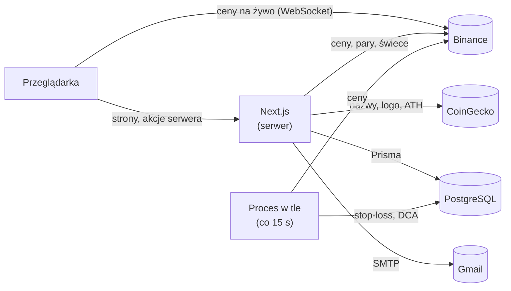

# Crypto Sandbox

**Symulator handlu kryptowalutami** — handlujesz po prawdziwych cenach z giełdy Binance, ale na wirtualnym kapitale.
Każdy nowy użytkownik dostaje **10 000 USDT** i może sprawdzić swoje strategie bez ryzykowania prawdziwych pieniędzy.

> Projekt powstał w ramach pracy inżynierskiej.

---

## Funkcje

**Handel**

- ponad **870 par** z Binance (USDT, USDC, FDUSD, BTC, ETH, BNB, EUR), w tym pary krzyżowe typu ETH/BTC
- **zlecenia rynkowe** po najlepszej cenie z arkusza zleceń (kupno po _ask_, sprzedaż po _bid_), prowizja 0,1%
- **zlecenia warunkowe**: stop-loss, take-profit i kupno po zadanej cenie
- **automatyczne kupowanie (DCA)**: stała kwota codziennie, co tydzień lub co 30 dni
- zasady giełdy respektowane jak na Binance: krok ceny, krok ilości, minimalna wartość zlecenia

**Rynek**

- lista wszystkich par z wyszukiwarką, filtrem waluty i sortowaniem po każdej kolumnie
- **ceny na żywo** przez WebSocket Binance
- wykres świecowy (1m – 1D) z wolumenem i linią maksimum wszech czasów
- karta monety z danymi CoinGecko: ATH, ATL, kapitalizacja, podaż

**Analityka portfela**

- wartość portfela w USDT, **zysk/strata i ROI**
- wynik każdej monety liczony metodą **średniej ceny zakupu** (także dla par krzyżowych)
- wykres wartości portfela w czasie i wykres składu portfela
- **ranking użytkowników** według ROI (z możliwością ukrycia się)

**Konto i bezpieczeństwo**

- rejestracja, logowanie, **weryfikacja dwuetapowa (TOTP)** — Google Authenticator, Authy itp. — z kodami zapasowymi
- potwierdzenie adresu e-mail i reset hasła przez mail
- **limit prób** logowania i kodów 2FA, lista aktywnych sesji z wylogowaniem innych urządzeń
- profil ze zdjęciem, zmiana danych i hasła, reset portfela, usunięcie konta
- nagłówki bezpieczeństwa (CSP, HSTS i inne)

---

## Stos technologiczny

| Warstwa          | Technologia                                                                             |
| ---------------- | --------------------------------------------------------------------------------------- |
| Aplikacja        | [Next.js 16](https://nextjs.org) (App Router, Cache Components), React 19, TypeScript   |
| Baza danych      | PostgreSQL ([Neon](https://neon.tech)) + [Prisma 7](https://www.prisma.io)              |
| Uwierzytelnianie | [Better Auth](https://www.better-auth.com) (e-mail + hasło, TOTP, limit prób)           |
| Wygląd           | Tailwind CSS 4, [lightweight-charts](https://tradingview.github.io/lightweight-charts/) |
| Dane rynkowe     | Binance API (REST + WebSocket), CoinGecko API                                           |
| Maile            | SMTP (nodemailer) — domyślnie Gmail                                                     |
| Jakość kodu      | ESLint, Prettier, walidacja danych przez Zod                                            |

---

## Architektura



Najważniejsze decyzje:

- **Cenę zlecenia zawsze ustala serwer**, pobierając ją z arkusza zleceń Binance — przeglądarka wysyła tylko kwotę.
- **Zlecenie to jedna transakcja bazodanowa**: zdjęcie środków, dopisanie monety i zapis transakcji wykonują się razem albo wcale.
  Saldo jest zdejmowane warunkowo (`UPDATE … WHERE amount >= kwota`), więc równoległe zlecenia nie wydadzą tych samych środków dwa razy.
- **Wszystkie kwoty liczone są na typie `Decimal`**, bez błędów zaokrągleń liczb zmiennoprzecinkowych; baza dodatkowo pilnuje ograniczeń (`CHECK amount >= 0`).
- **Proces w tle** (start razem z serwerem) wykonuje zlecenia warunkowe i plany DCA. Każde zlecenie jest najpierw „rezerwowane”,
  więc nie wykona się dwa razy nawet przy kilku instancjach serwera.

---

## Uruchomienie

**Wymagania:** Node.js 20+, baza PostgreSQL (np. darmowa na [neon.tech](https://neon.tech)).

```bash
git clone <adres-repozytorium>
cd crypto-sandbox
npm install
cp .env.example .env     # uzupełnij zmienne (opis niżej)

npm run db:deploy        # tworzy tabele w bazie
npm run db:seed          # dodaje walutę startową (USDT)
npm run sync:markets     # pobiera pary z Binance oraz nazwy i logo z CoinGecko (~40 s)
npm run dev              # http://localhost:3000
```

### Zmienne środowiskowe (`.env`)

| Zmienna                  | Wymagana | Opis                                                                                       |
| ------------------------ | :------: | ------------------------------------------------------------------------------------------ |
| `DATABASE_URL`           |    ✓     | adres bazy PostgreSQL                                                                      |
| `BETTER_AUTH_SECRET`     |    ✓     | losowy sekret do sesji — wygeneruj: `openssl rand -base64 32`                              |
| `BETTER_AUTH_URL`        |    ✓     | adres aplikacji, lokalnie `http://localhost:3000`                                          |
| `SMTP_USER`              |          | adres Gmail, z którego wychodzą maile                                                      |
| `SMTP_PASSWORD`          |          | [hasło aplikacji Google](https://myaccount.google.com/apppasswords) (wymaga 2FA na koncie) |
| `SMTP_HOST`, `SMTP_PORT` |          | tylko dla innej poczty niż Gmail, np. `smtp.wp.pl` i `465`                                 |
| `COINGECKO_API_KEY`      |          | darmowy klucz „Demo” CoinGecko — wyższy limit zapytań                                      |

Bez danych SMTP aplikacja działa normalnie, a link z maila (potwierdzenie e-maila, reset hasła) pojawia się w terminalu.

### Skrypty

| Komenda                | Działanie                                       |
| ---------------------- | ----------------------------------------------- |
| `npm run dev`          | serwer deweloperski                             |
| `npm run build`        | wersja produkcyjna                              |
| `npm start`            | uruchomienie wersji produkcyjnej                |
| `npm run sync:markets` | aktualizacja listy par i danych monet           |
| `npm run db:migrate`   | nowa migracja po zmianie `prisma/schema.prisma` |
| `npm run db:deploy`    | zastosowanie migracji                           |
| `npm run db:seed`      | dane startowe                                   |
| `npm run db:studio`    | podgląd bazy w przeglądarce (Prisma Studio)     |
| `npm run lint`         | sprawdzenie kodu (ESLint)                       |
| `npm run format`       | formatowanie kodu (Prettier)                    |

> Po zmianie schematu bazy uruchom `npm run db:migrate` i zrestartuj `npm run dev`.

---

## Struktura projektu

```
app/
  (auth)/              logowanie, rejestracja, kod 2FA, reset hasła
  (app)/dashboard/     wartość portfela, zysk/strata, wykresy, pozycje
  (app)/markets/       lista rynku i strona pary (wykres, panel zleceń, dane monety)
  (app)/orders/        zlecenia warunkowe i automatyczne kupowanie
  (app)/ranking/       ranking użytkowników według ROI
  (app)/profile/       zdjęcie, dane, hasło
  (app)/settings/      2FA, sesje, prywatność, reset portfela, usunięcie konta
  api/                 Better Auth, historia świec do wykresu
components/            wspólne komponenty UI (przyciski, tabele, strona, powiadomienia)
lib/
  actions/             akcje serwera (handel, konto)
  auth.ts, session.ts  uwierzytelnianie
  market/              Binance, CoinGecko, synchronizacja rynków, WebSocket
  trading/             silnik zleceń, portfel, zlecenia warunkowe i DCA
  portfolio/           wycena, zysk/strata, historia wartości, ranking
  jobs/                proces w tle wykonujący zlecenia i plany
  mail.ts              wysyłka maili
prisma/                schemat bazy, migracje, dane startowe
scripts/               synchronizacja rynków
```

---

## Ograniczenia

- To **symulator** — żadne zlecenie nie trafia na prawdziwą giełdę, a środki są wirtualne.
- Przy zleceniach warunkowych środki nie są blokowane na czas oczekiwania; sprawdzane są przy tworzeniu i przy wykonaniu.
- Proces w tle działa razem z serwerem; na platformach bez stale działającego serwera (np. Vercel) trzeba go wywoływać cronem.
